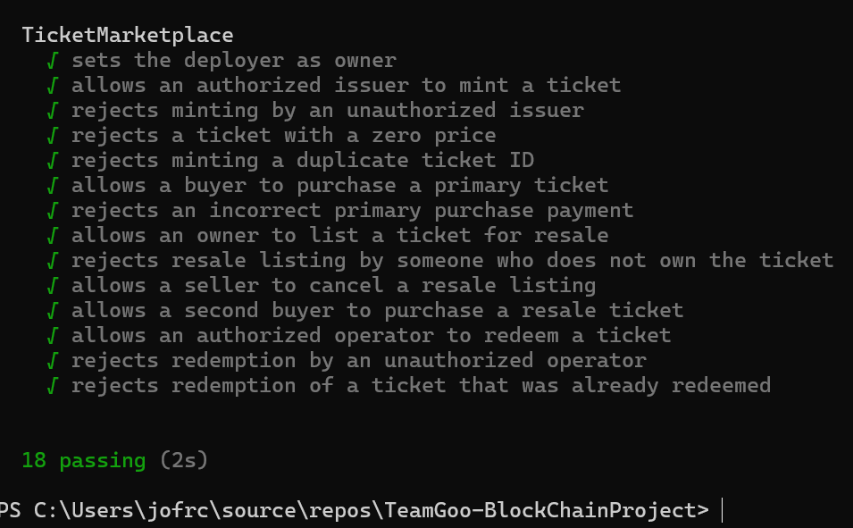
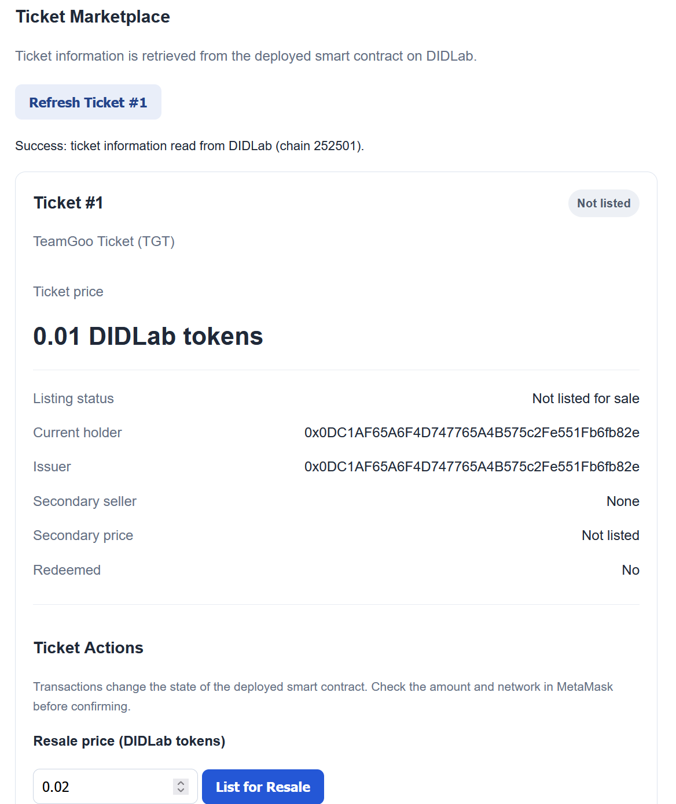
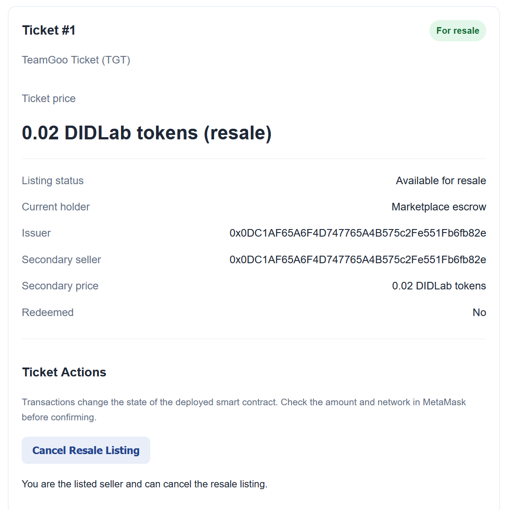
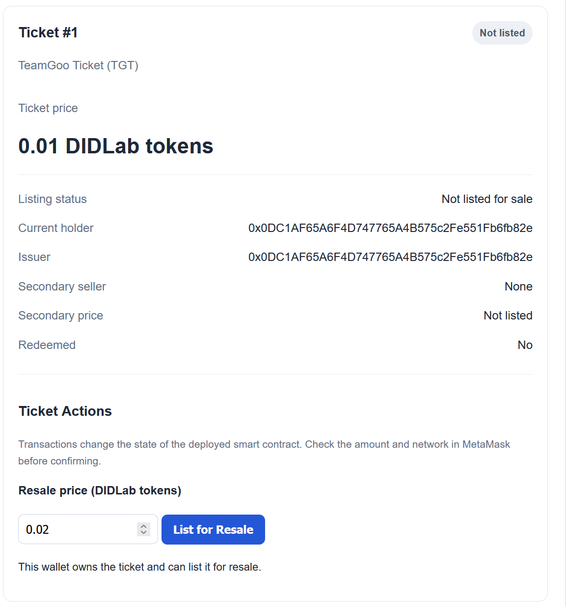

# Checkpoint Report — TeamGoo Ticket Marketplace

## 1. Project Identity

**Project:** Blockchain Ticket Marketplace  
**Team:** Joey Contreras, Lupe Campos  
**Live App:** https://teamgoo.didlab.org  
**Repository:** https://github.com/lc6cm/TeamGoo-BlockChainProject  
**Network:** DIDLab, Chain ID `252501`

## 2. Problem, Stakeholders, and Trust Boundaries

Ticket buyers and sellers need to verify ticket ownership, transfers, authenticity, and redemption status.

**Stakeholders:** Issuers, buyers, sellers, event operators, and marketplace operators.

Blockchain records are publicly verifiable. Personal information, ticket files, and QR codes remain off-chain. Real-world issuance and redemption still depend on authorized participants.

## 3. Suitability Verdict

**Verdict: PROCEED WITH REDESIGN**

Blockchain provides a shared, verifiable record of ticket ownership, transfers, listings, and redemption. However, it cannot independently verify real-world ticket authenticity or scanning events.

## 4. Architecture

The application uses a web frontend, ethers.js, MetaMask, a Solidity smart contract, and DIDLab RPC.

The frontend reads contract state and submits wallet-authorized transactions. The contract manages ticket ownership, purchases, resale listings, cancellation, and redemption.

## 5. On-Chain / Off-Chain Data

**On-chain:** Ticket IDs, ownership, listing prices, redemption status, and authorized addresses.

**Off-chain:** Personal information, payment information, ticket files, and QR codes.

## 6. Deployment Record

- **Network:** DIDLab
- **Chain ID:** `252501`
- **Contract:** `TicketMarketplace`
- **Address:** `0x98dEca57f98504fF09AcdBF1F2345ABF72EbA3c6`
- **Deployment transaction:** `0x8016127577e2a64eac0c1f7869f9142bbd0869c281a7faba7bff6eb6547ff833`
- **Deployment script:** `scripts/deploy.js`

The deployment script authorizes the deployer as issuer and operator and creates sample Ticket #1.

## 7. Features Completed

- MetaMask wallet connection and network detection.
- Live ticket information read from DIDLab.
- Primary ticket purchase.
- Resale listing and cancellation.
- Contract address displayed on the website.

Ticket #1 was purchased, listed for resale at `0.02` DIDLab tokens, and returned to the owner's wallet after cancellation.

**Evidence to attach:** Website screenshots and transaction hashes for the purchase, resale, and cancellation.

## 8. Testing Evidence

The most recent recorded test run had **31 passing tests** across `ProjectAnchor`, `TicketMarketplace`, and 'TicketRecordRegistry.

4 ProjectAnchor, 15 TicketMarketplace, and 12 TicketRecordRegistry

**All Tests Passing for Ticket Marketplace**

**Ticket Bought**

**Ticket Being Resold**

**Ticket Resale Canceled**

## 9. Security and Privacy Review

### Access Control

The TicketMarketplace contract restricts administrative functions using OpenZeppelin Ownable and authorized issuer/operator mappings.

- Only the contract owner can authorize issuers and operators.
- Only authorized issuers can mint tickets.
- Only authorized operators can redeem tickets.
- Only ticket owners can list tickets for resale.
- Only the original seller can cancel a resale listing.

The TicketRecordRegistry contract uses OpenZeppelin AccessControl to enforce ADMIN, SUBMITTER, and VERIFIER roles.

Automated tests confirmed that unauthorized operations were rejected.

### Vulnerability Classes Reviewed

**1. Access Control**

Tested unauthorized ticket minting, resale listing, redemption, record anchoring, and verification.

Result: Unauthorized operations were rejected.

**2. Reentrancy**

Reviewed the primary and secondary purchase functions, which use OpenZeppelin ReentrancyGuard.

Created ReentrancyAttacker.sol to simulate a malicious issuer attempting another purchase during its payout callback.

Result: The attempted reentrant purchase failed, while the legitimate purchase succeeded. The test demonstrates that the attack was unsuccessful, although existing ticket-state checks also prevent the repeated purchase.

**3. Invalid State Transitions and Input Validation**

Tested duplicate ticket IDs, zero prices, incorrect payments, double redemption, duplicate registry records, and repeated verification.

Result: All tested invalid operations were rejected.

### Privacy Review

The marketplace stores ticket IDs, wallet addresses, prices, ownership, and redemption status.

The registry stores record identifiers, file digests, and IPFS CIDs.

Ticket records are encrypted using AES-256-GCM before being uploaded to IPFS. Encryption keys remain off-chain and are excluded from Git.

No names, email addresses, phone numbers, or other direct personal identifiers were identified in the reviewed on-chain data.

Wallet addresses remain publicly visible and pseudonymous, so transaction activity can potentially be linked to individuals.

### Residual Risks

- Authorized operators can redeem eligible tickets without an additional on-chain approval from the holder.
- Compromised administrator or operator keys could enable unauthorized actions.
- Public IPFS ciphertext could become readable if its encryption key is compromised.
- Direct payouts to contracts that reject Ether can cause purchase transactions to revert.

### Security Testing Results

The complete Hardhat test suite passed:

- ProjectAnchor: 4 tests.
- TicketMarketplace: 15 tests.
- TicketRecordRegistry: 12 tests.

**Total: 31 passing tests.**

No confirmed exploitable reentrancy vulnerability was found in the tested purchase scenario. The review does not constitute a comprehensive independent security audit.

## 10. Performance Measurements

Performance was measured using real transactions on DIDLab (Chain ID 252501).

### Gas Usage

| Operation | Gas Used | Transaction Status |
|---|---:|---|
| Resale listing | 92,834 | Successful |
| Resale purchase | 44,293 | Successful |
| Ticket minting | 149,022 | Successful |

### Transaction Timing

A new ticket minting transaction was submitted through the Hardhat console and timed using JavaScript Date.now().

- Submission latency: 0.412 seconds.
- Confirmation wait: 0.668 seconds.
- Total transaction time: 1.080 seconds.
- Gas used: 149,022.
- Block number: 7,268,873.
- Receipt status: 1 (successful).

These are actual client-observed measurements, not estimates. The confirmation wait measures the interval between receiving the transaction hash and observing its receipt. Timing for the earlier resale transactions was not recorded.

### Transaction Evidence

**Resale listing**

- Transaction: `0x93f3e27a96e8fc9850255cacb26f7a475d227b0e9a74dda9e8bb5297a6028bbc`
- Block: 7,233,643
- Gas: 92,834

**Resale purchase**

- Transaction: `0x9b7b02d09b1cb25aa616cfeeafa1b9d5c20c72691f605af1b51ceb46b8b93826`
- Block: 7,233,762
- Gas: 44,293

**Ticket minting**

- Transaction: `0x3e8a0d6148c78e4264151ceb2cda8a22c0a59b89e65e50df2a1f302a9403522c`
- Block: 7,268,873
- Gas: 149,022

### On-Chain State Verification

After minting Ticket #999:

- The marketplace held the newly minted ticket in escrow.
- The issuer was Wallet A.
- The primary listing price was 0.01 TRUST.
- The ticket was available for primary purchase.
- The total ticket count increased from 1 to 2.

This confirms that the transaction successfully updated the deployed contract state.

### Performance Limitations

The timing results represent one observed minting transaction, not an average across multiple runs. Network conditions, RPC response times, and transaction complexity may affect future measurements.
## 11. AI Development Record

ChatGPT assisted with understanding requirements, Solidity and Git concepts, debugging, documentation, testing, deployment, and frontend integration. See `docs/AI_RECORD.md`.

## 12. Individual Contributions

**Joey Contreras:** DIDLab setup, smart contracts, tests, deployment, frontend integration, and evidence collection.

**Lupe Campos:** Repository ownership, project planning, and documentation.

Confirm contributions using Git history.

## 13. Risks and Blockers

The contract relies on authorized participants to report real-world issuance and redemption accurately. Earlier deployment and compiler compatibility issues were resolved.

## 14. Checkpoint 3 Completion Checklist

- Test the marketplace end to end with separate wallets.
- Ensure primary purchases and resale transactions work for other users.
- Display pending, confirmed, failed, and rejected transaction states.
- Handle missing wallets and incorrect networks.
- Extend automated tests for the new features.
- Complete security, privacy, and performance reviews.
- Ensure both team members contribute commits since Checkpoint 2.

## 15. Change Log

Since Checkpoint 1, the team implemented and deployed `TicketMarketplace`, added automated tests and deployment scripts, connected the frontend to live contract state, and executed primary purchase and resale transactions. These changes demonstrate the project's transition from planning to a working blockchain application.

## 16. Progress Since Checkpoint 2

The following work was completed after Checkpoint 2. It represents continued development and testing, not the completion of Checkpoint 3.

### Frontend Improvements

- Added clearer MetaMask wallet connection and DIDLab network checks, including handling for missing wallets and incorrect networks.
- Continued reading Ticket #1 directly from the deployed contract to display its owner, issuer, price, listing status, and redemption status.
- Added transaction evidence messages for pending, confirmed, on-chain reverted, and wallet-rejected outcomes.
- Added a transaction receipt verification feature that displays the result of an existing transaction hash.
- Added a listener for the contract's `Transfer` event that calls `loadTicket()` to refresh displayed ticket information.

### Blockchain Testing and Evidence

- Completed a secondary ticket purchase using a separate test wallet and verified the successful transaction on the DIDLab explorer.
- Confirmed that the frontend detected a `Transfer` event for Ticket #1 after a resale listing.
- Verified an actual reverted transaction on-chain: `0x4307d2aefa6d6087dc1f7c5fe2cc3fd90618b6e31936fc90812b763ea3ae85cf`. Its receipt had status `0`, used 23,784 gas, and did not change contract state.
- Tested rejection in MetaMask and confirmed the frontend reported that no transaction hash was created.
- Ran the Hardhat contract test suite again: **31 tests passing** (4 `ProjectAnchor` tests, 15 `TicketMarketplace`, 12 'TicketRecordRegistry' tests).

### Repository and Documentation

- Organized a separate `frontend/` directory containing `server.js`, `package.json`, `public/index.html`, and an ABI generated from the compiled `TicketMarketplace` contract.
- Tested the frontend locally with `npm start` and confirmed that it could read live DIDLab ticket data.
- Reviewed `.gitignore` to exclude `.env`, generated files, and a local HTML backup.
- Performed preliminary checks of Git history for accidentally committed key material; these checks did not reveal an obvious private key, but they were not a comprehensive audit.
- Updated `docs/AI_RECORD.md` to document AI assistance and how its suggestions were verified.

These updates extend the working Checkpoint 2 implementation.

## 17. Additional Work — Encryption, Access Control, and Security

The following work was completed after Checkpoint 2 as additional development for the TeamGoo Ticket Marketplace. This work is not a new checkpoint report.

### Encrypted Ticket Records and IPFS

- Created a ticket issuance record for Ticket #1.
- Encrypted the record using AES-256-GCM before uploading it to IPFS through Pinata.
- Stored the encryption key locally and excluded it from Git.
- Uploaded the encrypted file with CID `bafkreif6muweduc3z54kkpofwgwlq7htt4i4jmj66i75nfl7wns6mbbfma`.
- Confirmed the encrypted file was 306 bytes.
- Retrieved the file programmatically and verified its SHA-256 hash matched the expected digest.

**Original SHA-256:**

`be652c41d05bcf78a53dc5b1acb87cf39f11c4b13ef23fd6957fb365e6042560`

**IPFS gateway:**

https://gateway.pinata.cloud/ipfs/bafkreif6muweduc3z54kkpofwgwlq7htt4i4jmj66i75nfl7wns6mbbfma

### Smart Contract Development and Deployment

- Developed `TicketRecordRegistry.sol` to anchor encrypted ticket records on DIDLab.
- Implemented ADMIN, SUBMITTER, and VERIFIER roles using OpenZeppelin AccessControl.
- Added `anchorRecord()` and `verifyRecord()` functions.
- Added `RecordAnchored` and `RecordVerified` events.
- Implemented custom errors for unauthorized access, self-verification, duplicate records, nonexistent records, invalid inputs, and repeated verification.

**Registry contract:** `0x2d8A3B142378f6dAd929c6aF73bD8c9C0d823963`

**Deployment transaction:** `0xa3726c9fe60321a5e1bad842312936b93a025d56f95956c0e90418de713cb536`

**Successful anchoring transaction:** `0x9403210dae9e05b328f1e0c7a2646e1ee5751ab1fff8399acc5d5dfb8d873eb9`

**Record ID:** `0x27b32b0fbeb1c80a6150d865a7ae16fab97fa1c458ca24e3ce8494fba44b1281`

The anchored record stores the encrypted file's SHA-256 digest and IPFS CID. The `RecordAnchored` event was confirmed using the DIDLab explorer.

### File Integrity Demonstration

- Created `scripts/bitFlipDemo.js` to demonstrate file integrity.
- Modified exactly one bit of the encrypted file.
- Confirmed the original and modified files produced different SHA-256 hashes.

**Original hash:** `be652c41d05bcf78a53dc5b1acb87cf39f11c4b13ef23fd6957fb365e6042560`

**Modified hash:** `aa77d32448dc584875ccd7d6e9d469e503f755e5410acf7a41633c60e86de1b6`

**File size:** 306 bytes (2,448 bits)

**Bits changed:** 1

This demonstrates that changing even one bit causes the computed digest to differ from the anchored digest.

### Role-Based Access Control Testing

Three wallets were used to demonstrate permission enforcement.

- **Wallet A:** Authorized submitter and administrator.
- **Wallet B:** Authorized independent verifier.
- **Wallet C:** Unauthorized wallet with neither SUBMITTER nor VERIFIER permissions.

The following outcomes were demonstrated:

1. Wallet A successfully anchored the encrypted ticket record.
2. Wallet B successfully verified the record, emitting `RecordVerified`.
3. Wallet A attempted self-verification and received `SelfVerification`.
4. Wallet C attempted unauthorized verification and received `NotAuthorized`.

**Successful verification transaction:**

`0xa1524e24c75e3d3fe6018e49f474b69aaf8443b32c5c3cf6ae4a28e1c95f5577`

Wallet A was temporarily granted VERIFIER permission to test self-verification. The permission was revoked afterward, and `hasRole()` returned `false`.

**Role revocation transaction:**

`0xf0f459a7bb867221dcf4089923678690ab66218be0c0771485ec4388b49d210b`

### Automated Security Testing

Created and executed `test/TicketRecordRegistry.test.js`.

**Result: 12 tests passing.**

Tests covered:

- Successful anchoring and verification.
- Unauthorized anchoring.
- Unauthorized verification.
- Self-verification.
- Verification of nonexistent records.
- Duplicate record identifiers.
- Actions after role revocation.
- Empty record identifiers.
- Empty digests.
- Empty CIDs.
- Repeated verification.

All required security refusal paths passed.

### Frontend Security Demonstration

- Connected Wallet C to the deployed TeamGoo website.
- Confirmed the website displayed no available ticket action for that wallet and ticket state.
- Used the browser developer console to call `verifyRecord()` directly on `TicketRecordRegistry`.
- Confirmed the smart contract rejected the unauthorized call with `NotAuthorized`.
- Recorded revert data `0xea8e4eb5`.

This demonstrated that authorization is enforced by the smart contract rather than relying on frontend controls. The current frontend does not yet provide role-aware Anchor and Verify controls for the registry.

### Privacy and Governance Review

- Enumerated registry fields exposed through contract state, calldata, and events.
- Reviewed privacy risks associated with wallet addresses, record identifiers, timestamps, and IPFS CIDs.
- Used a randomly generated record identifier instead of deriving it from personal information.
- Confirmed that wallet addresses are pseudonymous rather than anonymous.
- Evaluated the risks of publicly accessible encrypted records and compromised encryption keys.
- Analyzed the ADMIN role and its ability to grant or revoke permissions.
- Proposed multi-signature administrative control and timelocks as potential production safeguards.

These governance safeguards are recommendations and are not currently implemented in the deployed registry.

### Repository and Documentation

- Added `contracts/TicketRecordRegistry.sol`.
- Added `test/TicketRecordRegistry.test.js`.
- Added scripts for encryption, artifact verification, and bit-flipping.
- Updated `.gitignore` to exclude local off-chain files and encryption keys.
- Updated `docs/AI_RECORD.md` with the additional AI assistance and verification procedures.
- Prepared screenshots and written evidence for encryption, anchoring, access control, security testing, and privacy analysis.

### Remaining Work

- Integrate registry anchoring and verification controls into the ticket marketplace frontend.
- Regenerate and include the registry ABI for frontend integration.
- Confirm all required source files and documentation are committed.
- Verify that no encryption keys or private information are included in Git.
- Confirm contributions from both team members using Git history.

This additional work extends the existing TeamGoo Ticket Marketplace with encrypted off-chain records, on-chain integrity anchoring, independent verification, role-based permissions, and automated security testing.

Contribution Summary

Joey: Smart contract development, DIDLab deployment, encryption and IPFS testing, wallet permission testing, automated security tests, blockchain verification, and evidence collection.

Lupe: Repository management, project planning, documentation, CHECKPOINT_REPORT updates, and AI_RECORD updates.

Contributions will be confirmed using Git history.
