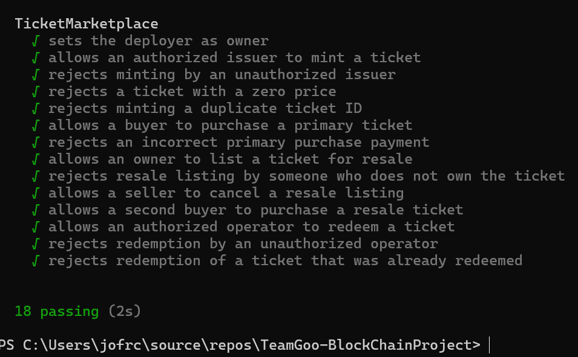
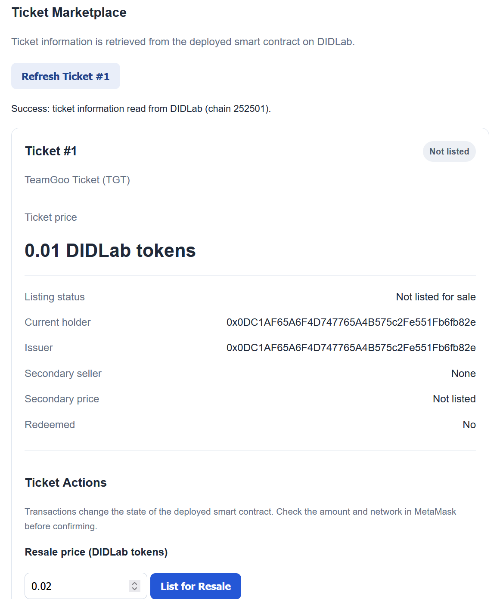
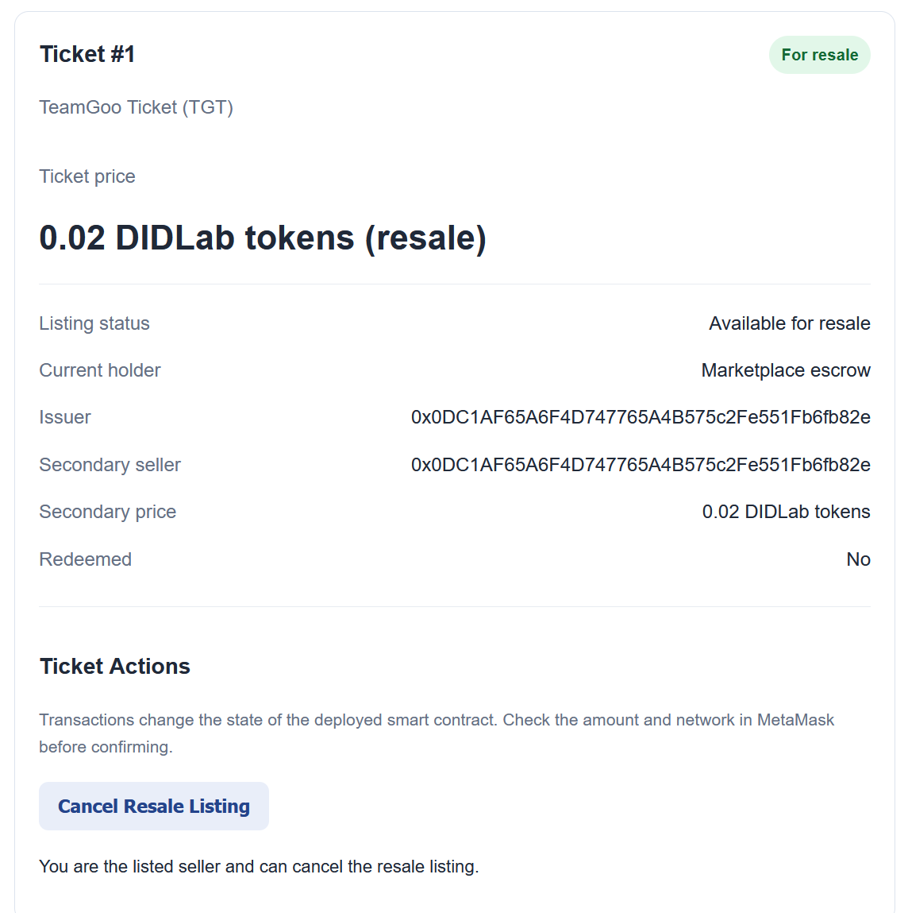
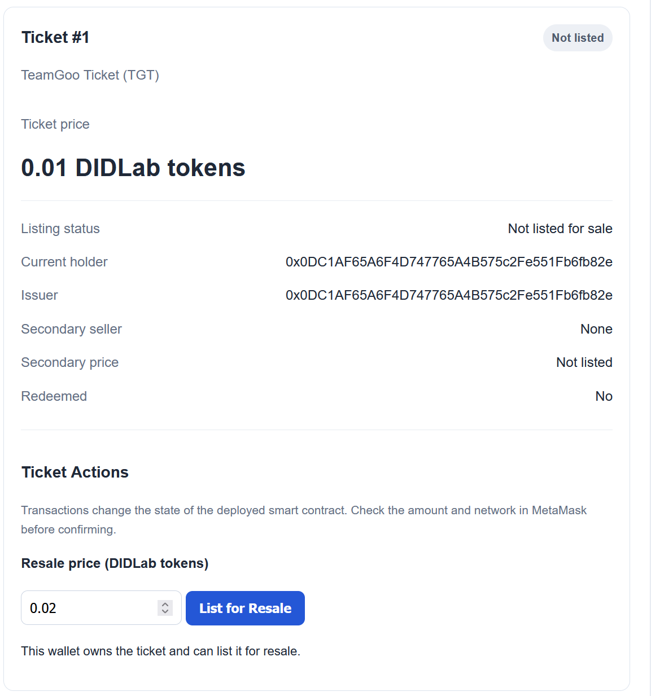

# Checkpoint 2 Report — TeamGoo Ticket Marketplace

## 1. Project Identity

**Project:** Blockchain Ticket Marketplace  
**Team:** Joey Contreras, Lupe Campos  
**Live App:** https://teamgoo.didlab.org  
**Repository:** https://github.com/lc6cm/TeamGoo-BlockChainProject  
**Network:** DIDLab, Chain ID `252501`

## 2. Problem, Stakeholders, and Trust Boundaries

Ticket buyers and sellers need to verify ticket ownership, transfers, authenticity, and redemption status.

**Stakeholders:** Issuers, buyers, sellers, event operators, and marketplace operators.

Blockchain records are publicly verifiable. Personal information, ticket files, and QR codes remain off-chain. Real-world issuance and redemption still depend on authorized participants.

## 3. Suitability Verdict

**Verdict: PROCEED WITH REDESIGN**

Blockchain provides a shared, verifiable record of ticket ownership, transfers, listings, and redemption. However, it cannot independently verify real-world ticket authenticity or scanning events.

## 4. Architecture

The application uses a web frontend, ethers.js, MetaMask, a Solidity smart contract, and DIDLab RPC.

The frontend reads contract state and submits wallet-authorized transactions. The contract manages ticket ownership, purchases, resale listings, cancellation, and redemption.

## 5. On-Chain / Off-Chain Data

**On-chain:** Ticket IDs, ownership, listing prices, redemption status, and authorized addresses.

**Off-chain:** Personal information, payment information, ticket files, and QR codes.

## 6. Deployment Record

- **Network:** DIDLab
- **Chain ID:** `252501`
- **Contract:** `TicketMarketplace`
- **Address:** `0x98dEca57f98504fF09AcdBF1F2345ABF72EbA3c6`
- **Deployment transaction:** `0x8016127577e2a64eac0c1f7869f9142bbd0869c281a7faba7bff6eb6547ff833`
- **Deployment script:** `scripts/deploy.js`

The deployment script authorizes the deployer as issuer and operator and creates sample Ticket #1.

## 7. Features Completed

- MetaMask wallet connection and network detection.
- Live ticket information read from DIDLab.
- Primary ticket purchase.
- Resale listing and cancellation.
- Contract address displayed on the website.

Ticket #1 was purchased, listed for resale at `0.02` DIDLab tokens, and returned to the owner's wallet after cancellation.

**Evidence to attach:** Website screenshots and transaction hashes for the purchase, resale, and cancellation.

## 8. Testing Evidence

The most recent recorded test run had **18 passing tests** across `ProjectAnchor` and `TicketMarketplace`.

**All Tests Passing for Ticket Marketplace**

**Ticket Bought**

**Ticket Being Resold**

**Ticket Resale Canceled**

## 9. Security and Privacy Review

*Reserved for Checkpoint 3.*

## 10. Performance Measurements

*Reserved for Checkpoint 3.*

## 11. AI Development Record

ChatGPT assisted with understanding requirements, Solidity and Git concepts, debugging, documentation, testing, deployment, and frontend integration. See `docs/AI_RECORD.md`.

## 12. Individual Contributions

**Joey Contreras:** DIDLab setup, smart contracts, tests, deployment, frontend integration, and evidence collection.

**Lupe Campos:** Repository ownership, project planning, and documentation.

Confirm contributions using Git history.

## 13. Risks and Blockers

The contract relies on authorized participants to report real-world issuance and redemption accurately. Earlier deployment and compiler compatibility issues were resolved.

## 14. Plan for Checkpoint 3

- Test the marketplace end to end with separate wallets.
- Ensure primary purchases and resale transactions work for other users.
- Display pending, confirmed, failed, and rejected transaction states.
- Handle missing wallets and incorrect networks.
- Extend automated tests for the new features.
- Complete security, privacy, and performance reviews.
- Ensure both team members contribute commits since Checkpoint 2.

## 15. Change Log

Since Checkpoint 1, the team implemented and deployed `TicketMarketplace`, added automated tests and deployment scripts, connected the frontend to live contract state, and executed primary purchase and resale transactions. These changes demonstrate the project's transition from planning to a working blockchain application.

## 16. Progress Since Checkpoint 2

The following work was completed after Checkpoint 2. It represents continued development and testing, not the completion of Checkpoint 3.

### Frontend Improvements

- Added clearer MetaMask wallet connection and DIDLab network checks, including handling for missing wallets and incorrect networks.
- Continued reading Ticket #1 directly from the deployed contract to display its owner, issuer, price, listing status, and redemption status.
- Added transaction evidence messages for pending, confirmed, on-chain reverted, and wallet-rejected outcomes.
- Added a transaction receipt verification feature that displays the result of an existing transaction hash.
- Added a listener for the contract's `Transfer` event that calls `loadTicket()` to refresh displayed ticket information.

### Blockchain Testing and Evidence

- Completed a secondary ticket purchase using a separate test wallet and verified the successful transaction on the DIDLab explorer.
- Confirmed that the frontend detected a `Transfer` event for Ticket #1 after a resale listing.
- Verified an actual reverted transaction on-chain: `0x4307d2aefa6d6087dc1f7c5fe2cc3fd90618b6e31936fc90812b763ea3ae85cf`. Its receipt had status `0`, used 23,784 gas, and did not change contract state.
- Tested rejection in MetaMask and confirmed the frontend reported that no transaction hash was created.
- Ran the Hardhat contract test suite again: **18 tests passing** (4 `ProjectAnchor` tests and 14 `TicketMarketplace` tests).

### Repository and Documentation

- Organized a separate `frontend/` directory containing `server.js`, `package.json`, `public/index.html`, and an ABI generated from the compiled `TicketMarketplace` contract.
- Tested the frontend locally with `npm start` and confirmed that it could read live DIDLab ticket data.
- Reviewed `.gitignore` to exclude `.env`, generated files, and a local HTML backup.
- Performed preliminary checks of Git history for accidentally committed key material; these checks did not reveal an obvious private key, but they were not a comprehensive audit.
- Updated `docs/AI_RECORD.md` to document AI assistance and how its suggestions were verified.

These updates extend the working Checkpoint 2 implementation. Remaining Checkpoint 3 work will be addressed when that checkpoint begins.

### Contribution Summary

- Joey: Repo organization, tested frontend, tested contract states, verified events
- Lupe: Documentation, updated CHECKPOINT_REPORT, updated AI_RECORD
